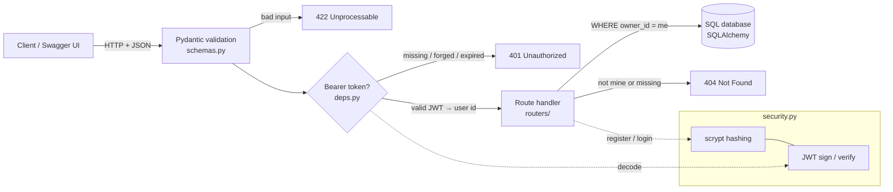

# Secure Notes API

[](https://github.com/paulmadojutimi94/secure-notes-api/actions/workflows/ci.yml)

An authenticated REST API built with **FastAPI**. Users register, log in, and manage private notes. **No user can read, change, delete, or even detect another user's notes.**

> New to backend engineering? Start with [LEARN.md](LEARN.md). For a line-by-line walkthrough of the code, see [CHEATSHEET.md](CHEATSHEET.md).

## The problem

A basic CRUD app trusts whoever calls it. A real one has to answer three questions on every request:

1. **Who are you?** (authentication: registration, password hashing, login tokens)
2. **Is what you sent sane?** (input validation)
3. **Are you allowed to touch *this* row?** (authorisation and object ownership)

The third question is where real systems break. *Broken Object Level Authorization* (BOLA, also called IDOR) is **#1 on the OWASP API Security Top 10**: you are logged in, you change `/notes/7` to `/notes/8`, and you see a stranger's data. This project is built to make that impossible, and the test suite attacks it to prove it.

## Architecture



| Layer | File | Job |
|---|---|---|
| Config | `app/config.py` | Reads secrets and settings from environment variables |
| Database | `app/database.py`, `app/models.py` | Tables `users` and `notes` (SQLite by default, Postgres via `DATABASE_URL`) |
| Validation | `app/schemas.py` | Email format, password length 12–128, title 1–200, body ≤ 10k, **unknown fields rejected** |
| Security | `app/security.py` | scrypt password hashing, JWT creation and verification |
| Auth dependency | `app/deps.py` | Turns `Authorization: Bearer …` into a `User`, or 401 |
| Routes | `app/routers/auth.py`, `app/routers/notes.py` | `/auth/register`, `/auth/login`, `/auth/me`, `/notes` CRUD |

## Quick start

```bash
git clone https://github.com/paulmadojutimi94/secure-notes-api && cd secure-notes-api
python -m venv .venv && source .venv/bin/activate
pip install -r requirements-dev.txt
export SECRET_KEY=$(python -c "import secrets; print(secrets.token_urlsafe(48))")
uvicorn app.main:app --reload
```

Open <http://127.0.0.1:8000/docs>, register a user, click **Authorize**, and log in with that email and password.

```bash
pytest -q                 # 54 tests
python scripts/eval.py    # regenerates the numbers below
```

## API

| Method | Path | Auth | Purpose |
|---|---|---|---|
| POST | `/auth/register` | — | Create account (JSON `email`, `password`) → 201 |
| POST | `/auth/login` | — | Form `username`=email, `password` → `{access_token, expires_in}` |
| GET | `/auth/me` | Bearer | The current user |
| POST | `/notes` | Bearer | Create a note |
| GET | `/notes?limit&offset` | Bearer | List **your** notes (limit 1–100) |
| GET / PATCH / DELETE | `/notes/{id}` | Bearer | Read / partly update / delete **your** note; anyone else's gives 404 |
| GET | `/health` | — | Liveness check |

## Eval results

Produced by `scripts/eval.py` in [GitHub Actions](https://github.com/paulmadojutimi94/secure-notes-api/actions) (Python 3.12, ubuntu-latest, run on 12 Nov 2026), with production hashing cost.

| Metric | Result |
|---|---|
| Tests passing | **54 / 54 (100%)** on Python 3.11, 3.12, 3.13 |
| Attack success rate | **0 / 14 (0%)**: IDOR read/update/delete, list leak, ID enumeration, mass assignment, forged key, `alg=none`, expired token, deleted-user token, 3× SQL injection in login, SQL injection in note |
| Password hashing | scrypt N=2^17, r=8, p=1 (OWASP minimum), 16-byte salt |
| Cost per request | $0 marginal; no paid APIs. Main cost is CPU: about 0.4 s of one core per login |

**Latency (in-process via TestClient, ms):**

| Endpoint | Runs | p50 | p95 |
|---|---|---|---|
| `POST /auth/register` | 20 | 398.6 | 410.6 |
| `POST /auth/login` | 20 | 398.7 | 402.2 |
| `POST /notes` | 200 | 4.1 | 4.6 |
| `GET /notes/{id}` | 200 | 3.9 | 4.1 |
| `GET /notes?limit=20` | 200 | 3.9 | 4.3 |
| `GET /notes/{id}` (someone else's) | 200 | 3.5 | 3.9 |
| `POST /auth/login` (wrong password) | 20 | 399.5 | 402.9 |
| `POST /auth/login` (unknown email) | 20 | 400.2 | 424.6 |

**How to read this:**
- Login and register are slow **on purpose**. scrypt spends about 0.4 s and 128 MiB of RAM per guess, so an attacker who steals the database can only try a few guesses per second per core. Everything else is around 4 ms.
- The last two rows matter for security. A wrong password and an unknown email take the **same** time, so response timing can't reveal which emails have accounts.
- These numbers are in-process, without a network or a real server. Shared CI runners are noisy: an earlier run measured login at 265 ms p50.

## Known failures and limitations

| # | Limitation | Impact | Mitigation today |
|---|---|---|---|
| 1 | **No rate limiting or lockout** on `/auth/login` | Online password guessing is limited only by scrypt's CPU cost, and the same cost lets an attacker tie up CPU (DoS) | Put rate limiting at the proxy (nginx / API gateway). See next steps |
| 2 | **Tokens can't be revoked.** A stolen JWT works until it expires | Up to 30 min of misuse | Short expiry (`ACCESS_TOKEN_MINUTES`) |
| 3 | **Registration reveals whether an email exists** (409) | Account enumeration through `/register` | Accepted trade-off for clear UX; login doesn't leak |
| 4 | Tables created with `create_all`, **no migrations** | Schema changes need manual work | Add Alembic before any production use |
| 5 | Email check is a simple regex, not RFC-complete | Some odd but valid addresses are rejected | Swap in `pydantic[email]` if needed |
| 6 | Each login uses 128 MiB of RAM | Many logins at once can exhaust memory on small servers | Lower `SCRYPT_N` via env; old hashes upgrade automatically on next login |
| 7 | Starlette deprecation warning in tests (`httpx` → `httpx2`) | Noise only | Track upstream |

## Next steps

1. Rate limit login (for example 5 per minute per IP plus per account) and return `429`.
2. Refresh tokens with rotation, plus a `jti` denylist for logout and revocation.
3. Alembic migrations; Postgres in docker-compose; run the suite against Postgres in CI.
4. Email verification and password reset flows.
5. Structured logging of auth failures (never passwords or tokens) for intrusion detection.
6. Load test behind uvicorn workers to get real network p95 latency.

## Postmortem

At one point the local test run showed "26 passed", but 28 API tests had been **silently skipped**. CI now fails the build on any skip. Full write-up: [POSTMORTEM.md](POSTMORTEM.md).

## Docs

[DESIGN.md](DESIGN.md) (decisions and rejected alternatives) · [CHEATSHEET.md](CHEATSHEET.md) (every line explained) · [LEARN.md](LEARN.md) (backend from first principles) · [POSTMORTEM.md](POSTMORTEM.md) · [DEMO.md](DEMO.md) (3-minute demo script)
